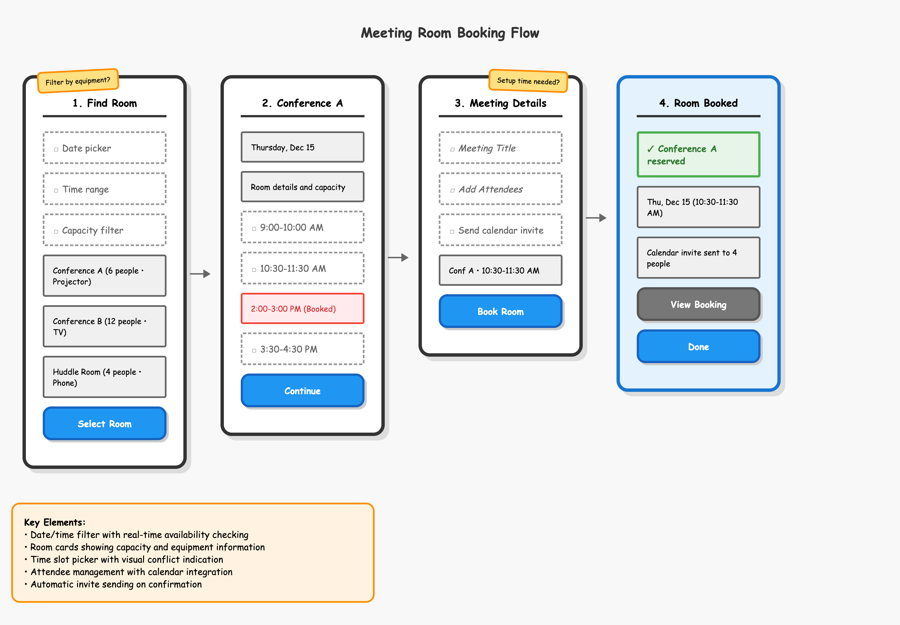

# Breadboarding

Create rough UX flow sketches in seconds. The goal is structure and interaction patterns, not visual detail. The thick borders and Comic Sans styling are deliberate, to keep a group from fixating on polish. Based on Basecamp's [breadboarding](https://basecamp.com/shapeup/1.3-chapter-04#breadboarding) method.



## Two workflows

**A. From a description** (e.g. "Create a flow for booking meeting rooms"):
1. Write a structured outline in the required format (below).
2. Generate the HTML from that outline.
3. Present both, plus a brief note on the key interaction patterns.

**B. From an outline** ("Generate HTML from this outline"): generate the HTML only, following the mapping rules exactly.

When iterating, prefer editing the outline and regenerating over hand-editing HTML. Always keep the outline and HTML in sync.

## Outline format

```markdown
# Flow Name - OUTLINE

## Flow Goal
[One sentence describing the end state/success outcome]

## Screen N: [Screen Name]
- input: □ [Description of input field]
- display: [Information shown to user]
- button: [Action Text] [primary/secondary]
- confirm: ✓ [Success message]
- note: [Question or annotation]
```

Only use this syntax. If a user's outline deviates (e.g. `**Purpose:**` or nested bullets), point out the specific problem, show the correct syntax, and ask for a correction rather than guessing intent.

## Element → HTML mapping

Use these class names exactly. No improvised classes.

| Outline | HTML |
| --- | --- |
| `input: □ [text]` | `<div class="input-area">[text]</div>` |
| `display: [text]` | `<div class="element">[text]</div>` |
| `button: [text]` | `<div class="button">[text]</div>` |
| `confirm: ✓ [text]` | `<div class="confirmation">[text]</div>` |
| `note: [text]` | `<div class="note">[text]</div>` |

Modifiers:

| Outline | HTML |
| --- | --- |
| `button: [text] [primary]` | `<div class="button primary">` |
| `button: [text] [secondary]` | `<div class="button secondary">` |
| `input: □ [text] [text field]` | `<div class="input-area text-field">□ [text]</div>` |
| `input: □ [text] [email inputs]` | `<div class="input-area email-inputs">□ [text]</div>` |
| `display: [text] [unavailable]` | `<div class="element unavailable">` |
| `note: [text] [right]` | `<div class="note right">` |
| `## Screen N: [Name] [email-screen]` | `<div class="screen email-screen">` |

Preserve the □ symbol in input areas and keep element order as written.

## HTML structure

Link the stylesheet at `assets/breadboarding-kit.css`. When writing output next to the user's work, copy that file alongside the HTML and link it relatively (`breadboarding-kit.css`).

```html
<!DOCTYPE html>
<html lang="en">
<head>
    <meta charset="UTF-8">
    <meta name="viewport" content="width=device-width, initial-scale=1.0">
    <title>[Flow Name] - Breadboarding</title>
    <link rel="stylesheet" href="breadboarding-kit.css">
</head>
<body>
    <div class="flow-title">[Flow Name]</div>
    <div class="flow-container">
        <div class="screen">
            <div class="screen-title">[Screen Name]</div>
            <!-- mapped elements -->
            <div class="arrow">→</div> <!-- every screen except the last -->
        </div>
    </div>
    <div class="discussion-box">
        <strong>Key Elements:</strong><br>
        • [key components from the flow]
    </div>
</body>
</html>
```

A complete worked example is in `references/demo-outline.md` and `references/demo-implementation.html`.

## Designing flows from a description

- Keep flows focused: 2-6 screens.
- Start with the entry point and end with a confirmation.
- One primary action per screen.
- Show realistic branching and error states (use `[unavailable]`).
- Include secondary actions (cancel, back) with `[secondary]`.
- Use `note:` for questions and edge cases; concise, generic-but-believable content, not final copy.

## Visual language (for reference)

- Square elements are content (display, input, confirm); rounded elements are actions (buttons).
- Blue = primary action, gray = secondary, green = success only, red = errors/unavailable only, yellow = annotations only.

## Quality checklist

- [ ] Outline follows the exact format (when created from a description)
- [ ] Every element maps to the correct class
- [ ] Flow title and discussion box included
- [ ] Arrows between screens, none after the last
- [ ] Stylesheet link resolves
